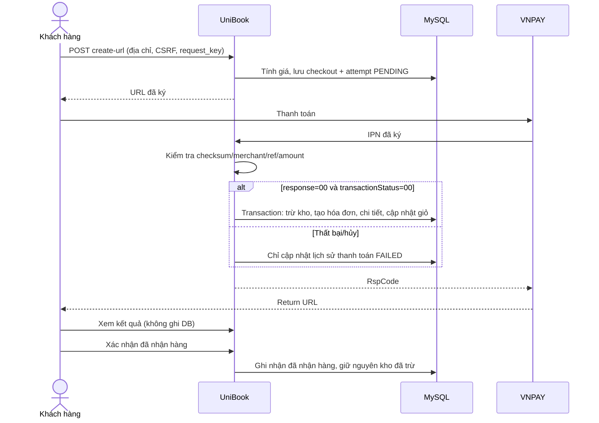

# UniBook: checkout, VNPAY Sandbox và địa chỉ giao hàng

Đã tích hợp checkout với database XAMPP `webbansach`. Cấu hình Sandbox cũ được nhập
từ Web2 vào `.env` local, không hiển thị hoặc ghi secret trong log. Migration thực
tế: [private/storefront-schema.sql](private/storefront-schema.sql). Bản sao lưu trước
migration nằm trong `private/backups/before-storefront-20260913.sql`, bị Apache chặn.

## Luồng đang chạy

- COD: tính giá từ DB, kiểm tra chủ địa chỉ/tồn kho rồi tạo
  hóa đơn + chi tiết + trừ kho + cập nhật giỏ trong **cùng một PDO transaction**.
  Trạng thái thanh toán là `PENDING`, chưa coi việc tạo đơn là đã thu tiền.
- VNPAY: chỉ tạo `checkout_sessions` và `checkout_payment_attempts`. Khi đang chờ,
  thất bại hoặc khách hủy, chưa tạo `hoadon/chitiethoadon`, chưa trừ kho/xóa giỏ.
- IPN: xác minh HMACSHA512, merchant, mã giao dịch, số tiền; chỉ khi cả mã phản hồi
  và trạng thái giao dịch là `00` mới tạo hóa đơn `PAID`. Tất cả trong một transaction.
  IPN lặp trả `02`; mã giao dịch thất bại `0` không bị lưu vào khóa UNIQUE.
- Return chỉ xác minh và hiển thị kết quả, không cập nhật DB. Không dùng Return làm IPN.
- Thanh toán lại sau IPN thất bại: quay về giỏ và đặt lại, mã giao dịch mới, tối đa
  5 lần thử lại cho cùng checkout. Yêu cầu gửi trùng được trả lại kết quả đã tạo.
- Chưa nhận IPN: giữ `PENDING`, không tự coi hết 15 phút là thất bại và tạo giao dịch
  lại cho cùng phiên vì có thể khách đã bị trừ tiền. Khi URL đã hết hạn, phiên cũ
  không khóa việc đặt đơn mới; giao diện nhắc khách kiểm tra nếu đã bị trừ tiền.
  Vẫn giữ attempt để đối soát và nhận IPN muộn. Hết hạn URL không phải kết quả thất bại/hoàn tiền.
- Thanh toán thành công: tạo hóa đơn, trừ kho và xóa đúng lượng đã mua khỏi giỏ.
  Số lượng khách thêm trong lúc thanh toán được giữ lại.
- Kho được trừ ngay khi hóa đơn ở trạng thái chờ xác nhận (`trangthai=0`).
  Cập nhật có điều kiện `sltonkho>=quantity` trong transaction ngăn bán vượt tồn kho.
  `stock_deducted=1` chống trừ lại khi đang giao/đã nhận; hủy đơn hoàn kho một lần.
  VNPAY đã trả tiền nhưng thiếu kho trước khi tạo hóa đơn được lưu `REVIEW` để xử lý,
  không phát hành hóa đơn vượt tồn. Chưa trả tiền qua VNPAY chưa giữ kho.
  Migration đơn chờ hiện có: `php payment/private/reserve-waiting-stock.php` (CLI,
  sao lưu trước thay đổi, chạy lại không trừ lặp).
- Mua ngay đi thẳng đến thanh toán với `buy_now` và `quantity`. Máy chủ đọc giá/tồn
  của đúng sách, không thêm hoặc xóa sản phẩm trong giỏ đang có. COD và VNPAY dùng
  chung snapshot đặt hàng; các dòng mua ngay có `cart_id=0`.
- Return thăm dò endpoint **chỉ đọc** `storefront-status.php` trong một phút để thông báo
  UniBook đã nhận IPN hay còn chờ. Không xóa giỏ hoặc đánh dấu PAID dựa vào Return.



## Endpoint và cấu hình

- `POST /qlpm/payment/create-url` hoặc
  `/qlpm/user/user/controller/thanhtoan.php?action=placeOrder`:
  đăng nhập bằng session UniBook, truyền `iddiachi`, `phuongthuctt`
  (`cod/bank/vnpay`), `csrf_token`, `request_key` hex 32–64 ký tự.
  Số tiền và ID khách từ trình duyệt không được sử dụng.
- `GET /qlpm/payment/vnpay-return`: trang kết quả.
- `GET /qlpm/payment/vnpay-ipn`: callback. Đường dẫn cũ
  `/qlpm/user/user/controller/vnpay.php?action=ipn` dùng chung xử lý.

**IPN cần đăng ký với merchant VNPAY:**

`https://canal-parlor-fiber.ngrok-free.dev/qlpm/payment/vnpay-ipn`

Return:
`https://canal-parlor-fiber.ngrok-free.dev/qlpm/payment/vnpay-return`

Ngrok/Apache/MySQL phải chạy. Cấu hình URL trong `.env` không tự thay đổi IPN đã
đăng ký trên hệ thống VNPAY. Trang Return thành công chưa chứng minh IPN đã đến.

Logic đang dùng: [private/StoreCheckout.php](private/StoreCheckout.php),
[private/Gateway.php](private/Gateway.php). `vnpay_legacy.sql` là schema adapter cũ,
không dùng cho luồng hiện tại.

## Địa chỉ

Danh mục local UTF-8: 34 tỉnh/thành và 3.321 phường/xã/đặc khu, tải từ
[Vietnam Provinces Open API](https://provinces.open-api.vn/api/v2/redoc).
Form thêm/sửa dùng cùng bộ chọn hai cấp; kiểm tra quan hệ tỉnh/phường phía server.
Giữ nguyên địa chỉ cũ khi chỉ sửa người nhận; chọn lại địa giới thì dùng danh mục mới.
Trường `huyen` của địa chỉ mới để chuỗi rỗng, không cần sửa schema hoặc xóa địa chỉ cũ.
Dữ liệu và nguồn: [../user/database/vietnam-addresses.README.md](../user/database/vietnam-addresses.README.md).

## Kiểm thử

```powershell
D:/xampp/php/php.exe payment/tests/storefront.php
D:/xampp/php/php.exe payment/tests/http.php
D:/nodejs/node.exe payment/tests/address-browser.cjs
```

Storefront test tạo database MariaDB riêng và dọn database đó sau khi chạy, không
sửa dữ liệu khách thật. Kiểm tra thiếu tồn kho, thiếu cấu hình, địa chỉ sai, lỗi insert
chi tiết sau insert hóa đơn (rollback thực), amount từ DB, thất bại/hủy, retry và
giới hạn retry, IPN giả/trùng/thành công, stock race và COD chờ thu tiền.
Browser test kiểm tra chữ Việt, đổi tỉnh reset phường, giữ địa chỉ cũ và khung rộng
375/390/1440px. HTTP test kiểm tra Return read-only, escape HTML và chữ ký.

## Phạm vi còn lại

Module độc lập `PaymentService.php` và schema `orders/payments/refunds` vẫn được giữ
làm tham khảo và có bộ test riêng. API hoàn tiền của module đó **chưa nối với
checkout_sessions/hoadon**; không truyền ID storefront vào API hoàn tiền độc lập.
Xem [REFERENCE-STANDALONE.md](REFERENCE-STANDALONE.md) để tham khảo state machine,
mã lỗi, refund và các giới hạn. Chưa có cơ chế tự đối soát giao dịch PENDING khi IPN
không về; cần xác nhận cấu hình IPN và đối soát merchant trước khi dùng thực tế.

Tài liệu giao thức:
[VNPAY PAY](https://sandbox.vnpayment.vn/apis/docs/thanh-toan-pay/pay.html).
