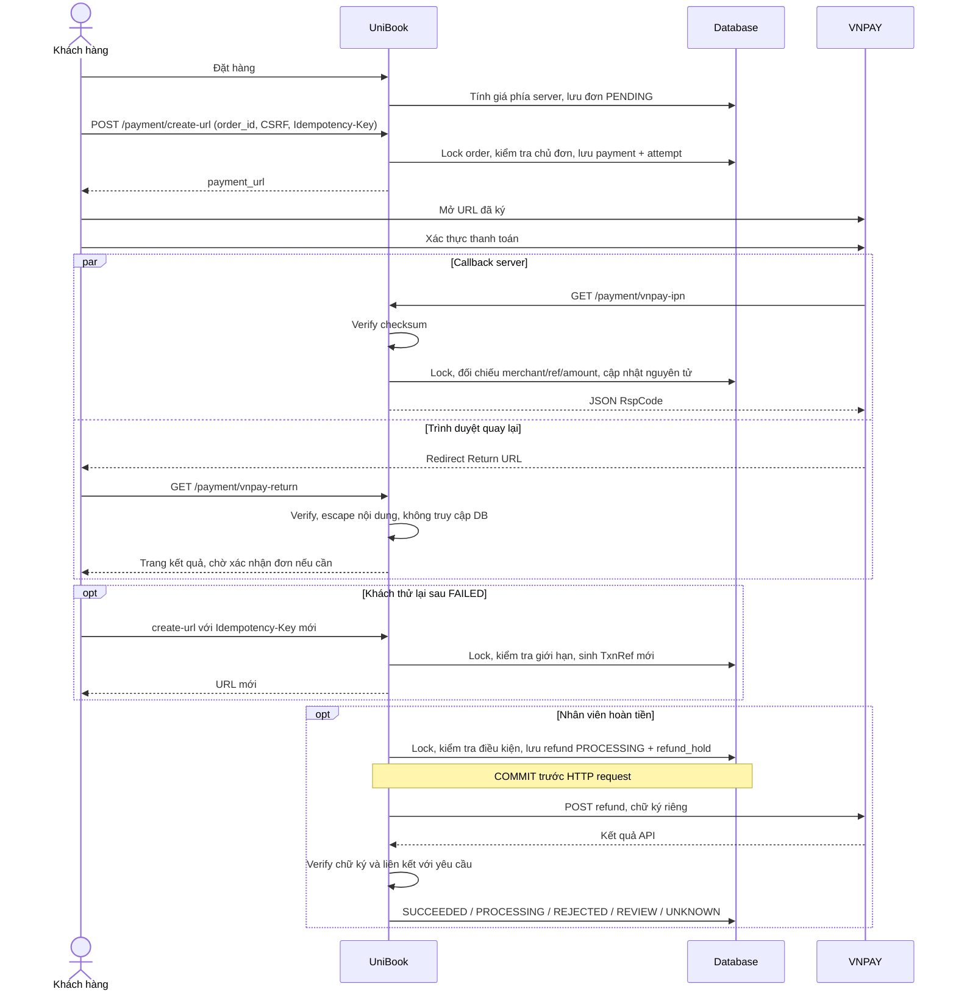
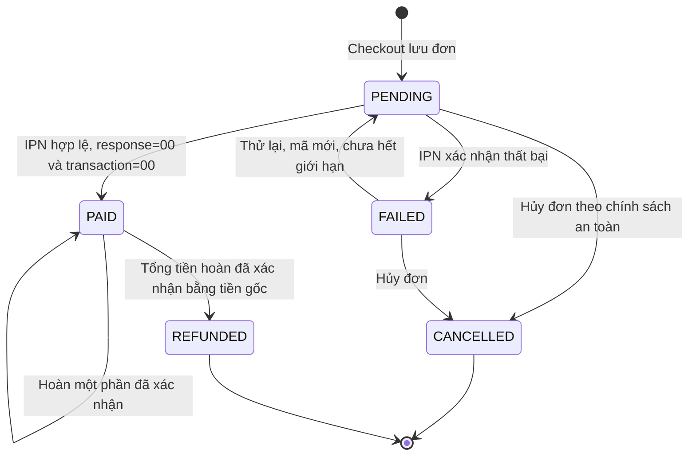

# Tài liệu tham khảo module VNPAY độc lập

Tài liệu dưới đây mô tả `PaymentService.php` với các bảng `orders/payments/refunds`,
không phải schema checkout đang chạy. Xem README.md cho cấu hình và luồng UniBook hiện tại.
Không chạy schema độc lập để thay thế migration storefront.

## 1. Sơ đồ luồng



Return và IPN có thể đến theo bất kỳ thứ tự nào. IPN phản hồi `00` hoặc `02` sẽ kết thúc cơ chế gọi lại; các lỗi còn lại hoặc timeout có thể được gọi lại tối đa 10 lần, cách 5 phút. [Tài liệu PAY](https://sandbox.vnpayment.vn/apis/docs/thanh-toan-pay/pay.html).

## 2. State machine của Order



- `orders.status` biểu thị trạng thái thanh toán của đơn; `fulfillment_status` biểu thị tiến độ xử lý/giao hàng.
- Đơn được hoàn tiền phải có `status=PAID`, `fulfillment_status=PENDING`, payment gốc có `transaction_status=00`, chưa quá 7 ngày kể từ `pay_date`, chưa có yêu cầu hoàn tiền chưa rõ kết quả.
- Hủy giao dịch tại VNPAY (`24`) làm lần thanh toán thất bại và đơn `FAILED`; không tự hủy đơn mua hàng.
- Hủy đơn là nghiệp vụ riêng của checkout, chưa cung cấp endpoint hủy trong module này. Khi có payment chưa rõ kết quả phải đối soát trước. Nếu callback thành công vẫn đến sau khi đơn bị hủy, lưu payment `PAID`, giữ đơn `CANCELLED` và bật `review_required`; không bỏ qua số tiền đã thu.
- `REFUNDED` chỉ dùng khi hoàn đủ. Hoàn một phần giữ `PAID` và tăng `refunded_amount`; dùng nhãn giao diện “Đã hoàn một phần”. Đây là điều chỉnh cần thiết để không diễn giải sai số tiền còn giữ.
- Refund `PROCESSING`, `UNKNOWN`, `REVIEW` giữ `refund_hold=1`. Không giao hàng hoặc gửi refund mới trong thời gian giữ này.

## 3. Database schema (SQL)

Toàn bộ DDL: [private/schema.sql](private/schema.sql). Dùng InnoDB; không dùng FLOAT/DOUBLE cho tiền.

| Bảng | Vai trò và ràng buộc chính |
|---|---|
| `orders` | Chủ đơn, số tiền VND bất biến, trạng thái thanh toán/giao hàng, số lần thử, số tiền đã hoàn |
| `payments` | Một dòng cho mỗi `vnp_TxnRef`; UNIQUE reference và mã VNPAY của giao dịch thành công |
| `payment_attempts` | Lịch sử từng lần thử; UNIQUE `(order_id, attempt_number)` và `(order_id, idempotency_key)` |
| `refunds` | Sổ yêu cầu hoàn; UNIQUE request ID và idempotency key; lưu trạng thái trung gian |
| `payment_logs` | Nhật ký callback, dữ liệu đối chiếu và thay đổi trạng thái |

`amount=100000` là 100.000 VND trong DB; số tiền gửi cổng là `10000000`. Các thời gian chuỗi gateway giữ nguyên GMT+7. Khoá DB luôn theo thứ tự order → payment → refund để giảm deadlock.

Migration không tự chạy khi nhận HTTP request. Tạo backup và chạy file SQL qua quy trình migration của hệ thống; nếu dự án đã có bảng `orders`, phải hợp nhất schema hoặc dùng database riêng thay vì chạy DDL mù quáng.

## 4. Code PHP cho các endpoint và refund

### Cấu hình

1. Copy `.env.example` thành `.env` và điền `vnp_TmnCode`, `vnp_HashSecret`, DSN, URL Return HTTPS public, IP server và khoá operator. Không đặt secret trong JavaScript.
2. Apache cần `mod_rewrite` và cho phép các quy tắc `.htaccess`. Khi chạy dưới `http://localhost/qlpm`, endpoint là `/qlpm/payment/...`; khi deploy tại document root, endpoint là `/payment/...`.
3. Đăng ký `https://<host>/qlpm/payment/vnpay-ipn` với VNPAY. Localhost không nhận được callback từ server VNPAY. Reverse proxy phải chuẩn hoá IP và cấu hình TLS ở server; code không tin `X-Forwarded-For` do client tự gửi.
4. Chặn `.env`, thư mục `private` và `tests` tại web server. Các quy tắc Apache được cung cấp; nếu đổi sang Nginx phải cấu hình tương đương, `.htaccess` không có hiệu lực. Hạn chế truy cập và thời gian lưu `raw_response`/audit theo quy định nội bộ.

Địa chỉ Sandbox, API 2.1.0 và tham số thanh toán đối chiếu theo [tài liệu PAY](https://sandbox.vnpayment.vn/apis/docs/thanh-toan-pay/pay.html). Module cố định các host Sandbox, dùng HMAC-SHA512 và `hash_equals`.

### File triển khai

| Chức năng | Mã đầy đủ |
|---|---|
| Router, auth, CSRF, error handler, JSON IPN | [index.php](index.php) |
| Tạo URL, RFC1738, checksum, HTTP refund | [private/Gateway.php](private/Gateway.php) |
| Transaction DB, retry, IPN, refund/idempotency | [private/PaymentService.php](private/PaymentService.php) |
| Trang Return không truy cập DB | [private/return.php](private/return.php), [return.css](return.css) |
| Đọc `.env`, PDO | [private/bootstrap.php](private/bootstrap.php) |
| CLI nhận kết quả refund đã ký để đối soát | [private/reconcile-refund.php](private/reconcile-refund.php) |

### POST /payment/create-url

Chỉ nhận `order_id`. Bắt buộc session `idkhachhang`, `X-CSRF-Token`, `Idempotency-Key`. Số tiền lấy từ `orders`, không đọc giá trị tiền do client gửi. Một lần đầu + tối đa 5 lần thử lại. Khóa order ngăn tạo hai payment đang chờ. Gửi lại cùng key trả cùng URL còn hiệu lực; thử lại sau FAILED phải dùng key mới.

Ví dụ handler cho nút “Thanh toán” / “Thanh toán lại” trong trang đơn hàng sau khi đã gắn schema mới:

```javascript
// Render orderId từ đơn của người dùng. Backend vẫn kiểm tra quyền sở hữu.
// Chỉ hiển thị nút thử lại nếu DB báo FAILED và không review_required.
// Giữ key khi mất mạng; chỉ xoá key khi lần thanh toán đã có kết quả FAILED.
async function payOrder(orderId, isNewAttempt = false) {
    const base = '/qlpm/payment'; // '/payment' nếu deploy tại root
    const storageKey = `unibook-pay-${orderId}`;
    if (isNewAttempt) sessionStorage.removeItem(storageKey);
    let key = sessionStorage.getItem(storageKey);
    if (!key) {
        key = crypto.randomUUID();
        sessionStorage.setItem(storageKey, key);
    }
    const csrfResponse = await fetch(`${base}/csrf`, {credentials: 'same-origin'});
    const csrf = await csrfResponse.json();
    if (!csrfResponse.ok) throw new Error(csrf.error);
    const response = await fetch(`${base}/create-url`, {
        method: 'POST', credentials: 'same-origin',
        headers: {'Content-Type': 'application/json',
                  'X-CSRF-Token': csrf.csrf_token, 'Idempotency-Key': key},
        body: JSON.stringify({order_id: orderId})
    });
    const result = await response.json();
    if (!response.ok) throw new Error(result.error);
    location.assign(result.payment_url);
}
// Bắt lỗi tại UI, hiện error.message và bật lại nút; không sinh key mới vì mất mạng.
```

### GET /payment/vnpay-return

Verify checksum, kiểm tra merchant, escape nội dung rồi render HTML. **Không mở PDO, không cập nhật DB, không xác nhận giao hàng.** Thông báo thành công được ghi rõ là kết quả VNPAY và đơn còn chờ server xác nhận. Callback không hợp lệ không hiển thị dữ liệu từ query string.

### GET /payment/vnpay-ipn

Verify trước khi mở DB; reject query có trùng tên tham số hoặc cú pháp array. Đối chiếu merchant, reference, amount. Trong một transaction: lock, kiểm tra đã xác nhận chưa, ghi payment, order và audit; commit rồi trả JSON. Gặp lỗi DB rollback và trả `99` để cổng gọi lại.

| RspCode | Điều kiện |
|---|---|
| `00` | Đã ghi nhận kết quả, kể cả kết quả thanh toán thất bại |
| `01` | Không tìm thấy reference/đơn của merchant |
| `02` | Lần thanh toán đã được xác nhận |
| `04` | Số tiền không khớp |
| `97` | Chữ ký không hợp lệ |
| `99` | Lỗi tạm thời, dữ liệu không đủ để xử lý |

Callback đã xác nhận nhưng có kết quả mâu thuẫn được ghi `IPN_CONFLICT`, bật review và không đảo ngược trạng thái. `confirmed_at`, UNIQUE constraints và row lock đảm bảo callback trùng không ghi nhận tiền hai lần.

### POST /payment/refund

Endpoint dành cho server quản trị, không gọi trực tiếp từ JavaScript khách hàng:

```http
POST /qlpm/payment/refund
Authorization: Bearer <PAYMENT_ADMIN_KEY>
Idempotency-Key: <UUID-cua-thao-tac-hoan-tien>
Content-Type: application/json

{"payment_id":123,"amount":50000}
```

Admin backend phải kiểm tra quyền nhân viên trước khi dùng khoá này; module định danh người gọi là `api-operator`. Tích hợp audit nhân viên thực nếu hệ thống có nhiều operator.

Hoàn tiền được đặt chỗ trước HTTP call. Timeout, HTTP lỗi, response sai chữ ký hoặc không liên kết được với request → `UNKNOWN`, giữ khoản đặt chỗ. Gửi lại cùng idempotency key chỉ đọc trạng thái đã lưu, không gửi request mới. Request khác trên cùng đơn bị chặn khi đang giữ.

Checksum refund dùng chuỗi trường theo thứ tự riêng, ngăn bằng `|`; không dùng hàm ký query URL. `vnp_TransactionDate` lấy từ CreateDate của payment gốc. Kết quả API cũng được xác thực và ràng buộc merchant, reference, amount, loại hoàn và nội dung request. [Đặc tả refund](https://sandbox.vnpayment.vn/apis/docs/truy-van-hoan-tien/querydr%26refund.html).

Hoàn đủ số tiền ban đầu dùng type `02`; sau một lần hoàn một phần, các lần hoàn tiếp theo kể cả hoàn phần còn lại vẫn dùng type `03`. Chỉ tăng số tiền đã hoàn khi kết quả xác thực xác nhận thành công.

### Hợp đồng tích hợp checkout, giao hàng và đối soát

Trước khi bật phương thức VNPAY trên UniBook:

- Trong **một PDO transaction**, lấy customer từ session, kiểm tra địa chỉ thuộc customer, khoá các dòng hàng/kho cần thiết, đọc giá sách/khuyến mãi từ DB, tính tổng bằng số nguyên VND và lưu order + chi tiết/snapshot giá. Chính sách giữ/trả kho phải được xác định rõ. Không dùng `tongtien` POST và không gọi các model tự mở PDO khác bên trong transaction này.
- Bảng `orders` ở module này chưa tự sinh từ `hoadon`. Chọn chuyển checkout sang schema mới hoặc tạo adapter có liên kết một-một với `hoadon` và cùng transaction. Không tự copy tổng tiền không đáng tin từ hóa đơn cũ.
- Gắn nút thanh toán vào order đã lưu và cập nhật trang lịch sử mua hàng để đọc đúng schema. Module không cung cấp endpoint để khách tự tạo order với giá tuỳ ý.
- Mọi writer chuyển đơn sang PROCESSING/SHIPPED phải lock cùng order, đòi `status=PAID`, `refund_hold=0`, `review_required=0`; nếu không sẽ race với hoàn tiền. Không cho sửa amount sau khi có payment.
- Tác vụ giao hàng, email hoặc xuất hóa đơn nên dùng transactional outbox của hệ thống. Module chỉ ghi trạng thái/audit, không gửi email hoặc trừ kho trong IPN.
- Payment hết thời gian trên URL nhưng chưa nhận IPN vẫn PENDING, **không tự coi là FAILED để mở lần trả tiền mới**. Vận hành cần querydr/đối soát với VNPAY khi mất callback. Module này chưa có scheduler/querydr worker tự động; đây là điều kiện triển khai còn phải hoàn thiện nếu cần tự phục hồi giao dịch không có callback.
- Refund UNKNOWN/PROCESSING cần đối soát. CLI chỉ chấp nhận response refund có chữ ký hợp lệ, liên kết đúng request. Không lấy JSON querydr đổi tên thành refund và không tự sửa DB từ ảnh chụp giao dịch. Khi không lấy được bằng chứng phù hợp, đối soát merchant/VNPAY theo quy trình vận hành; không gửi lại refund mù quáng.

## 5. Bảng mapping lỗi → thông báo user

| ResponseCode thanh toán | Nhóm | Thông báo ngắn |
|---|---|---|
| 00 | Thành công | Thanh toán thành công |
| 07 | Gian lận/nghi ngờ | Cần kiểm tra an toàn, liên hệ hỗ trợ |
| 09 | User | Chưa đăng ký thanh toán trực tuyến |
| 10 | User | Xác thực sai quá nhiều lần |
| 11 | User | Hết thời gian thanh toán |
| 12 | User | Thẻ/tài khoản bị khóa |
| 13 | User | OTP không đúng |
| 24 | User | Đã hủy giao dịch |
| 51 | User | Không đủ số dư |
| 65 | User | Vượt hạn mức ngày |
| 79 | User | Sai mật khẩu quá số lần cho phép |
| 75 | Hệ thống | Ngân hàng bảo trì |
| 99/khác | Hệ thống | Chưa thể hoàn tất, liên hệ hỗ trợ |

Đối chiếu [bảng mã VNPAY](https://sandbox.vnpayment.vn/apis/docs/bang-ma-loi/). Code `07` có thể đã trừ tiền: không tự cho thanh toán lại khi đang review.

**Refund:** `05`, `06`, `07`, `09` được đặc tả là `vnp_TransactionStatus`, không phải nhóm lỗi `vnp_ResponseCode` refund.

| TransactionStatus refund | Xử lý nội bộ |
|---|---|
| 05 | PROCESSING — VNPAY đang xử lý |
| 06 | PROCESSING — đã chuyển yêu cầu sang ngân hàng |
| 07 | REVIEW — kiểm tra gian lận, giữ khoản hoàn |
| 09 | REJECTED — bị từ chối |

ResponseCode `94` giữ chờ; `98`/`99` giữ UNKNOWN. Tài liệu bảng mã chung và trang refund có mô tả khác nhau cho một số ResponseCode (ví dụ `02`), vì vậy không hard-code thông báo “đã hoàn” từ ResponseCode đơn lẻ. [Trạng thái refund](https://sandbox.vnpayment.vn/apis/docs/truy-van-hoan-tien/querydr%26refund.html).

## 6. Checklist test case

Đã chạy:

```powershell
D:/xampp/php/php.exe payment/tests/run.php
D:/xampp/php/php.exe payment/tests/http.php
```

Kết quả: **94 kiểm tra nghiệp vụ + 5 kiểm tra endpoint**. Test dùng SQLite memory với DDL chuyển từ migration, fake transport refund và subprocess PHP. Không gọi VNPAY hoặc sửa database hiện tại. Những dòng log lỗi trong test là lỗi được cố tình giả lập.

- [x] Sort/encode và HMAC đối chiếu vector độc lập bằng Node crypto.
- [x] Tiền âm, float, scientific notation, quá giới hạn.
- [x] Create idempotency, sai chủ đơn, chặn payment đang chờ.
- [x] Thanh toán thành công; thất bại; hủy; timeout được cổng xác nhận.
- [x] Chỉ thành công khi cả hai mã bằng 00.
- [x] IPN chữ ký sai, trùng query key, array input, merchant sai, reference không có, số tiền sai.
- [x] IPN trùng; kết quả mâu thuẫn; callback đến sau expiry/hủy đơn.
- [x] Retry sinh reference mới; giới hạn 5 lần retry.
- [x] Hoàn một phần, hoàn đủ phần còn lại, vượt số tiền còn lại.
- [x] Hoàn trùng key, key dùng với dữ liệu khác.
- [x] Hoàn sau giao hàng/quá hạn bị chặn.
- [x] Refund 05/06/07/09; timeout; sai chữ ký; response của request khác.
- [x] Đối soát refund lặp lại không cộng tiền hai lần.
- [x] DB lỗi rollback; IPN retry sau phục hồi thành công.
- [x] Return chạy khi DB không sẵn sàng, escape nội dung query.
- [x] HTTP localhost từ chối truy cập `.env.example`, `private/schema.sql`, `tests/run.php` (403).
- [ ] Chạy migration và kiểm tra cạnh tranh thực bằng nhiều connection MySQL/InnoDB.
- [ ] Luồng thật trên Sandbox với credential merchant, Return public, IPN public và ngân hàng test.
- [ ] CSRF/session/key quản trị cùng checkout thực; thử gửi nhiều request đồng thời.
- [ ] Kiểm chứng race giao hàng/refund, outbox, kho và chính sách hủy trong hệ thống đã tích hợp.
- [ ] Đối soát khi mất IPN, crash giữa refund HTTP/DB commit, response 05/06 lâu ngày.
- [ ] Kiểm tra Safari/iPhone cho trang Return.

Thẻ Sandbox: **NCB — 9704198526191432198 — NGUYEN VAN A — 07/15 — OTP 123456**. Chỉ dùng trong Sandbox. [Danh sách thẻ test chính thức](https://sandbox.vnpayment.vn/apis/vnpay-demo/).

## 7. Edge case và điều kiện vận hành

1. `RspCode=00` là đã nhận IPN, không đồng nghĩa khách đã thanh toán thành công; xem payment status riêng.
2. Browser Return có thể không xảy ra; giao dịch vẫn phải được ghi nhận qua IPN. Return xảy ra trước IPN cũng không được cập nhật PAID.
3. Duplicate IPN phải verify và đối chiếu tiền trước khi trả `02`; không trả thành công chỉ vì nhìn thấy reference quen thuộc.
4. Timeout HTTP không chứng minh cổng chưa nhận request. Refund dùng sổ đặt chỗ bền vững; crash sau gửi HTTP vẫn giữ PROCESSING/UNKNOWN cho đối soát.
5. Không cho thử thanh toán lại khi còn giao dịch chưa rõ kết quả; tránh hai lần thu tiền cho một đơn. Tình huống callback muộn bất thường được audit/review.
6. Đồng hồ server cần đồng bộ; chữ ký/timezone dùng Asia/Ho_Chi_Minh. Không sửa CreateDate gốc khi tạo refund.
7. Không log secret, URL có chữ ký hoặc dữ liệu thẻ/OTP. Audit lưu payload giao dịch đã xác minh; bảo vệ bản backup và quyền đọc log.
8. Khoá cấu hình/secret và operator key cần có quy trình rotation; không tự đổi merchant/secret khi còn callback đang chờ nếu chưa hỗ trợ overlap key.
9. Giới hạn retry trong module là theo đơn. Bổ sung rate limit theo tài khoản/IP ở reverse proxy để ngăn tạo nhiều đơn spam.
10. Trước production cần hoàn thiện các mục checklist chưa chạy, tích hợp checkout/fulfillment và quy trình đối soát; test SQLite không chứng minh tính đúng của cạnh tranh InnoDB hay việc VNPAY đã chấp nhận merchant.
